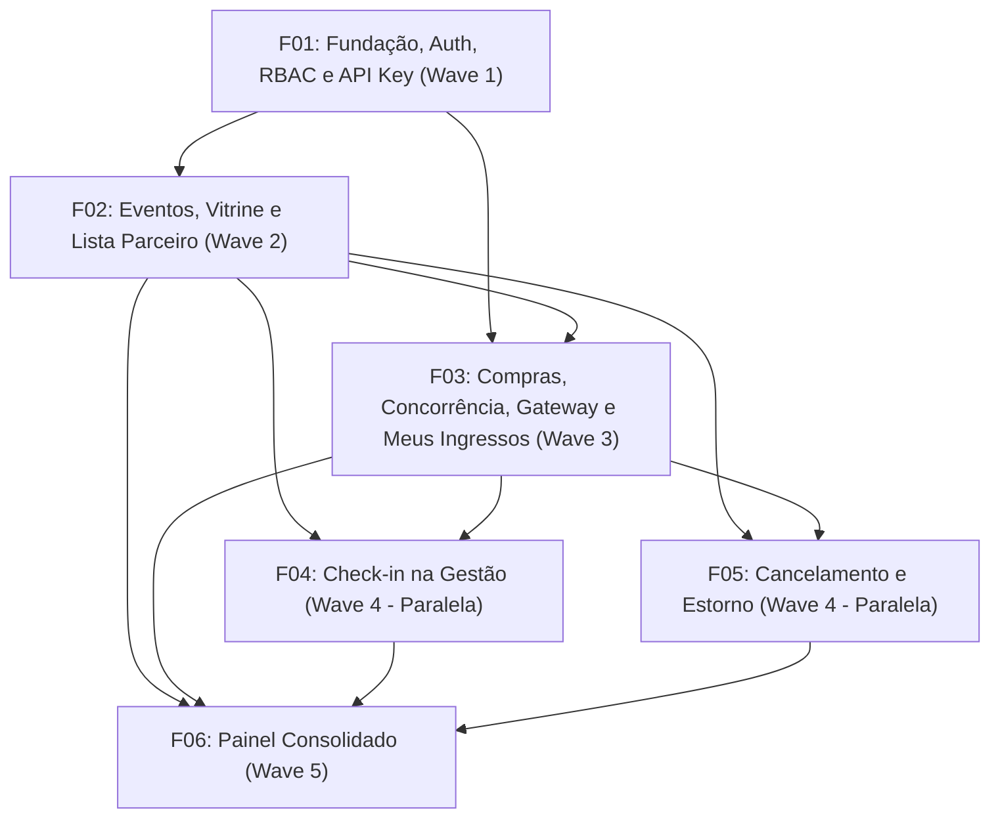

# PRD — Catraca (MVP)

## 1. Visão do Produto

A **Catraca** é uma plataforma de venda de ingressos para eventos pequenos (shows em bar, workshops, meetups) com dois canais de venda integrados — **vitrine web** (para participantes) e **API de parceiros** (para sistemas externos autenticados por chave) — além de uma **área de gestão por organizador** com criação/edição/publicação/cancelamento de eventos, check-in por código e painel consolidado de métricas e receita.

O produto opera localmente com um único comando, utilizando um **gateway de pagamento simulado** (assíncrono) como modo padrão, garantindo consistência forte de lotação sob compras simultâneas e integração sem regressões entre todas as features.

## 2. Perfis de Usuário

- **Visitante**: acessa sem login a vitrine de eventos publicados e não cancelados.
- **Participante**: cria a própria conta (nome, e-mail e senha), faz login/logout, compra ingressos na vitrine e visualiza os próprios ingressos em "Meus ingressos".
- **Organizador**: contas pré-criadas pela seed (Organizador A e Organizador B; sem autocadastro). Cria, edita, publica, cancela, faz check-in e acompanha o painel apenas dos próprios eventos.
- **Parceiro**: sistema externo autenticado pelo cabeçalho `X-Api-Key` na API de parceiros (`/api/partner/...`). Compras pela API não ficam vinculadas a contas de participante, mas participam integralmente de lotação, painel, check-in e cancelamento.

## 3. Modelo de Status de Ingresso

| Valor na API / Banco | Rótulo na Interface | Quando se aplica |
| :--- | :--- | :--- |
| `pending` | `pendente` | Compra criada, aguardando resposta do gateway |
| `confirmed` | `confirmado` | Gateway aprovou o pagamento |
| `declined` | `recusado` | Gateway recusou o pagamento |
| `cancelled` | `cancelado` | Estava pendente quando o evento foi cancelado |
| `refunded` | `estornado` | Estava confirmado quando o evento foi cancelado |

> **Observação**: check-in não é um status; é o atributo booleano independente `checkedIn` (no banco `checked_in`).

## 4. Regras de Negócio Rastreáveis (R01–R13)

- **R01**: Evento possui nome, data/hora de início, local, lotação (inteiro >= 1) e preço em reais (> 0). Data de início deve estar no futuro tanto ao criar quanto ao editar.
- **R02**: Todo evento nasce como rascunho (`draft`). Apenas eventos publicados (`published`) e não cancelados aparecem na vitrine e em `GET /api/partner/events` e aceitam compras.
- **R03**: A lotação nunca pode ficar menor que as vagas ocupadas (R05). Mudança de preço vale apenas para compras realizadas após a alteração.
- **R04**: Cada evento possui página de gestão com URL própria (`/organizador/eventos/:eventId`), reunindo edição, publicação, cancelamento, check-in e painel.
- **R05**: Vagas ocupadas = ingressos `pending` + `confirmed`. Vagas disponíveis = `capacity - vagas ocupadas`; em evento cancelado, são sempre `0`.
- **R06**: Cada compra é de exatamente 1 ingresso (vitrine ou API). Nasce `pending`, ocupa vaga imediatamente e é respondida sem aguardar o gateway (`202` na API).
- **R07**: Sem vaga disponível, a compra é recusada: vitrine exibe `Ingressos esgotados` e API responde `409 {"error":"sold_out"}`. Vagas ocupadas nunca excedem a lotação, mesmo sob compras simultâneas.
- **R08**: Aprovação do gateway muda ingresso para `confirmed`; recusa muda para `declined` e libera a vaga.
- **R09**: Cada ingresso tem código único usado no check-in. Em "Meus ingressos", o participante vê evento, status (rótulo em português) e código de cada ingresso comprado.
- **R10**: No check-in na página de gestão, o organizador informa o código e a primeira condição verdadeira nesta ordem define a mensagem exata:
  1. Código inexistente ou de outro evento -> `Ingresso inválido para este evento`
  2. Evento cancelado -> `Evento cancelado`
  3. Ingresso não confirmado -> `Ingresso não confirmado`
  4. Ingresso já passou pelo check-in -> `Ingresso já utilizado`
  5. Nenhuma das anteriores -> `Entrada liberada`
- **R11**: Organizador pode cancelar evento publicado; ação irreversível: sai da vitrine e da API, não aceita compras (`404 {"error":"event_not_available"}`), não pode ser editado nem republicado. Em até 10 segundos, ingressos `confirmed` viram `refunded` e `pending` viram `cancelled`. Respostas posteriores do gateway não alteram o status de nenhum ingresso.
- **R12**: Painel na página de gestão soma vendas da vitrine e da API com as definições: `Confirmados` (confirmados inclusive com check-in), `Pendentes`, `Check-ins` (confirmados com `checkedIn=true`), `Vagas disponíveis` (R05), `Receita` (soma do valor pago pelos confirmados no preço vigente em cada compra) e `Estornados`.
- **R13**: Na área de organizador, cada organizador só vê e opera os próprios eventos (inclusive via acesso direto à URL da página de gestão). Visitante e participante não acessam a área de organizador.

## 5. Divisão em Features (Consumes / Provides)

### F01 — Fundação, Autenticação, RBAC e Chave de Parceiro
- **Wave**: 1
- **Consumes**: Nenhuma (feature fundacional).
- **Provides**:
  - Harness de ambiente (`npm run up`, `npm run down`, `npm run gates`), Docker Compose (PostgreSQL 16 + app Node/Fastify/React) e migrations base.
  - Seed idempotente criando Organizador A, Organizador B e Participante Seed.
  - Cadastro de participante (nome, e-mail, senha), login/logout via cookie HTTP-only e endpoint `/api/auth/me`.
  - Middlewares de autenticação/autorização (`requireAuth`, `requireOrganizer`, `requireParticipant`) impondo R13.
  - Middleware `requirePartnerApiKey` validando `X-Api-Key` (`401 {"error":"unauthorized"}`).
  - Shell web com navegação, rotas de autenticação e proteção de área do organizador.

### F02 — Gestão de Eventos, Vitrine Pública e Listagem da API de Parceiros
- **Wave**: 2
- **Consumes**: `F01` (banco/migrations, autenticação, RBAC de organizador, middleware `X-Api-Key`, shell web).
- **Provides**:
  - Entidade e tabela `events` (`id`, `organizer_id`, `name`, `starts_at`, `location`, `capacity`, `price_cents`, `status`).
  - Endpoints do organizador: listar próprios eventos, criar evento (nasce `draft`), obter detalhe, editar (com validação de data futura R01 e lotação >= vagas ocupadas R03), publicar (R02).
  - Página de gestão com URL própria `/organizador/eventos/:eventId` (R04), protegida por ownership (R13) e preparada com slots de extensão para Check-in (F04), Cancelamento (F05) e Painel (F06).
  - Vitrine pública (`/` e `GET /api/events`) exibindo somente eventos `published` (R02) com vagas disponíveis (R05).
  - Rota fixa `GET /api/partner/events` retornando eventos `published` com `id`, `name`, `startsAt`, `priceCents` e `availableSeats` (R02, R05).

### F03 — Motor de Compras, Concorrência, Gateway Simulado, API de Parceiros e Meus Ingressos
- **Wave**: 3
- **Consumes**: `F01` (sessão de participante, middleware `X-Api-Key`), `F02` (tabela/serviço `events`, vitrine pública, página `/api/partner/events`).
- **Provides**:
  - Entidade e tabela `tickets` (`id`, `code` único, `event_id`, `user_id`, `buyer_email`, `price_cents`, `status`, `checked_in`).
  - Serviço transacional de compra com trava pessimista `SELECT ... FOR UPDATE` na linha do evento (garantindo R05, R06, R07 sob 30+ requisições simultâneas) e snapshot de `price_cents` vigente (R03).
  - Gateway de pagamento simulado assíncrono (finais `0001`..`0004` e demais finais, validação de 16 dígitos antes da criação, atualização condicional segura de `pending` -> `confirmed`/`declined`, R08).
  - Rotas fixas `POST /api/partner/events/:eventId/purchases` (ordem de erro `422` -> `404` -> `409`, sucesso `202`) e `GET /api/partner/tickets/:ticketId` (`200` ou `404 ticket_not_found`, funcionando para ambos os canais).
  - Fluxo de compra na vitrine (exibindo `Ingressos esgotados` quando sem vaga, R07) e página "Meus ingressos" (`/meus-ingressos`, exibindo evento, status e código, R09).

### F04 — Check-in de Ingressos na Página de Gestão
- **Wave**: 4 *(paralela com F05)*
- **Consumes**: `F02` (página de gestão `/organizador/eventos/:eventId`, eventos e ownership R13), `F03` (tabela `tickets`, códigos únicos, status e atributo `checked_in`).
- **Provides**:
  - Endpoint `POST /api/organizer/events/:eventId/checkin` aplicando a tabela de decisão em ordem estrita de R10 dentro de transação.
  - Marcação irreversível de `checked_in = true` (refletida em `GET /api/partner/tickets/:ticketId`).
  - Componente de Check-in integrado à página de gestão `/organizador/eventos/:eventId` exibindo a mensagem literal exata de R10.

### F05 — Cancelamento Irreversível de Eventos e Reconciliação com Gateway
- **Wave**: 4 *(paralela com F04)*
- **Consumes**: `F02` (eventos, edição/publicação, vitrine, `GET /api/partner/events`, página de gestão), `F03` (tabela `tickets`, motor de compras e callback assíncrono do gateway).
- **Provides**:
  - Endpoint `POST /api/organizer/events/:eventId/cancel` executando em transação atômica (com lock na linha do evento): marcação de `events.status = 'cancelled'`, `confirmed` -> `refunded` e `pending` -> `cancelled` (em <= 10 segundos, R11).
  - Garantia de irreversibilidade: bloqueio de edição e republicação (R11), remoção da vitrine e de `GET /api/partner/events` (R02), rejeição de compras com `404 event_not_available` (R11), vagas disponíveis = 0 (R05).
  - Blindagem contra resposta tardia do gateway (cartões `0003`/`0004` após 30–40s nunca alteram ingressos `cancelled`/`refunded`, R11).
  - Ação de cancelamento irreversível na página de gestão `/organizador/eventos/:eventId` desabilitando edição após cancelamento.

### F06 — Painel Consolidado de Métricas e Receita do Evento
- **Wave**: 5
- **Consumes**: `F02` (página de gestão `/organizador/eventos/:eventId`, lotação e ownership R13), `F03` (ingressos de vitrine e API, `status` e `price_cents` histórico), `F04` (`checked_in`), `F05` (status `cancelled` do evento e ingressos `refunded`/`cancelled`).
- **Provides**:
  - Endpoint `GET /api/organizer/events/:eventId/panel` (e dados no payload de gestão) computando em consulta consistente: `confirmedCount`, `pendingCount`, `checkedInCount`, `availableSeats` (0 se cancelado), `revenueCents` (soma de `price_cents` apenas de `confirmed`) e `refundedCount`.
  - Componente de Painel na página de gestão exibindo exatamente os rótulos `Confirmados`, `Pendentes`, `Check-ins`, `Vagas disponíveis`, `Receita` (em `R$`) e `Estornados` (R12).

## 6. Grafo de Dependências e Waves

### Plano de Waves

| Wave | Features | Execução | Justificativa |
| :--- | :--- | :--- | :--- |
| **Wave 1** | `F01` | Sequencial | Estabelece banco, migrations, seed, autenticação, RBAC, chave de parceiro e harness. |
| **Wave 2** | `F02` | Sequencial | Cria o domínio de eventos, página de gestão, vitrine e listagem de parceiros sobre `F01`. |
| **Wave 3** | `F03` | Sequencial | Implementa o domínio de ingressos, lock de concorrência, gateway simulado e compras sobre `F01`+`F02`. |
| **Wave 4** | `F04`, `F05` | **Paralela (2 branches + 2 PRs simultâneos)** | Check-in e Cancelamento dependem apenas de `F02`+`F03`, sem dependência entre si; integrados à `main` por PRs com resolução explícita de integração na página de gestão. |
| **Wave 5** | `F06` | Sequencial | Consolida no painel todos os sinais produzidos por `F02`, `F03`, `F04` e `F05`. |

## 7. Critérios de Aceite por Feature

### F01 — Fundação, Autenticação, RBAC e Chave de Parceiro
- **AC-F01-1**: `npm run up` sobe o stack em clone limpo, executa migrations e carrega seed com 2 organizadores e 1 participante; reexecutar `npm run down` + `npm run up` funciona sem erro e mantém credenciais válidas.
- **AC-F01-2**: Participante cria conta (nome, e-mail, senha), entra e sai pela interface; organizador não possui cadastro público e entra com credenciais da seed.
- **AC-F01-3** *(R13)*: Visitante e participante não conseguem acessar rotas `/organizador/*` nem endpoints `/api/organizer/*` (recebendo 401/403).
- **AC-F01-4**: Qualquer rota `/api/partner/*` sem `X-Api-Key` ou com chave inválida retorna `401 {"error":"unauthorized"}`.

### F02 — Gestão de Eventos, Vitrine Pública e Listagem da API de Parceiros
- **AC-F02-1** *(R01)*: Criação e edição validam nome, local, lotação (inteiro >= 1), preço (> 0) e data de início estritamente no futuro; data no passado é rejeitada.
- **AC-F02-2** *(R02)*: Evento recém-criado nasce `draft` e não aparece na vitrine nem em `GET /api/partner/events`; após publicação, aparece em ambos com `priceCents` e `availableSeats` corretos.
- **AC-F02-3** *(R03)*: Aumentar lotação é aceito; reduzir lotação abaixo das vagas ocupadas é rejeitado; alteração de preço é persistida apenas para compras futuras.
- **AC-F02-4** *(R04, R13)*: Cada evento tem página de gestão em `/organizador/eventos/:eventId`; Organizador B não vê eventos de A na lista nem dados do evento ao abrir a URL direta de A.

### F03 — Motor de Compras, Concorrência, Gateway Simulado, API de Parceiros e Meus Ingressos
- **AC-F03-1** *(R05, R06, R08)*: Compra pela vitrine e pela API cria 1 ingresso `pending`, ocupa vaga imediatamente, responde sem aguardar o gateway (`202` na API) e transita conforme o cartão (`0001` -> `confirmed` em 2–5s; `0002`/outros -> `declined` em 2–5s liberando vaga; `0003` -> `confirmed` em 30–40s; `0004` -> `declined` em 30–40s liberando vaga).
- **AC-F03-2** *(R07)*: Sem vaga disponível, a vitrine exibe `Ingressos esgotados` e a API retorna `409 {"error":"sold_out"}`; em 30 compras simultâneas num evento de lotação 5 (testado em múltiplas rodadas), ocorrem exatamente 5 respostas `202` e 25 respostas `409`.
- **AC-F03-3** *(R09)*: Cada ingresso recebe código único; em "Meus ingressos", o participante visualiza evento, rótulo de status em português e código de cada ingresso comprado.
- **AC-F03-4**: API de parceiros segue rigorosamente o contrato fixo em `POST /api/partner/events/:eventId/purchases` (ordem de erro `422 invalid_request` -> `404 event_not_available` -> `409 sold_out`, incluindo cartão != 16 dígitos antes de criar ingresso) e `GET /api/partner/tickets/:ticketId` (`200` com `checkedIn` ou `404 ticket_not_found`, para ambos os canais).

### F04 — Check-in de Ingressos na Página de Gestão
- **AC-F04-1** *(R04, R10)*: Na página de gestão `/organizador/eventos/:eventId`, informar código aplica a precedência exata de R10 e exibe literalmente: `Ingresso inválido para este evento`, `Evento cancelado`, `Ingresso não confirmado`, `Ingresso já utilizado` ou `Entrada liberada`.
- **AC-F04-2** *(R10)*: Check-in bem-sucedido altera apenas `checkedIn` para `true` sem mudar `status` (`confirmed`), e nova tentativa com o mesmo código retorna `Ingresso já utilizado`.
- **AC-F04-3** *(R13)*: Apenas o organizador dono do evento pode realizar check-in naquele evento.

### F05 — Cancelamento Irreversível de Eventos e Reconciliação com Gateway
- **AC-F05-1** *(R02, R05, R11)*: Cancelar evento publicado é irreversível: remove o evento da vitrine e de `GET /api/partner/events`, zera vagas disponíveis, bloqueia edição/republicação e faz compras na API responderem `404 {"error":"event_not_available"}`.
- **AC-F05-2** *(R11)*: Em até 10 segundos após o cancelamento, todos os ingressos `confirmed` passam a `refunded` e todos os `pending` passam a `cancelled`.
- **AC-F05-3** *(R11)*: Resposta do gateway que chegar após o cancelamento (ex.: cartão `0003` ou `0004` após 30–40s) não altera o status de nenhum ingresso (`cancelled` permanece `cancelled`; `refunded` permanece `refunded`).
- **AC-F05-4** *(R13)*: Apenas o organizador dono do evento pode cancelá-lo.

### F06 — Painel Consolidado de Métricas e Receita do Evento
- **AC-F06-1** *(R04, R12)*: Página de gestão exibe o painel com `Confirmados`, `Pendentes`, `Check-ins`, `Vagas disponíveis`, `Receita` e `Estornados` consolidando vendas da vitrine e da API de parceiros.
- **AC-F06-2** *(R03, R12)*: `Receita` soma `priceCents` vigente no momento de cada compra apenas para ingressos `confirmed` (nunca soma `pending`, `declined`, `cancelled` nem `refunded`).
- **AC-F06-3** *(R05, R12, R13)*: Em evento cancelado, `Vagas disponíveis` = `0`, `Confirmados` = `0`, `Pendentes` = `0`, `Receita` = `R$ 0,00` e `Estornados` reflete os ingressos estornados; apenas o organizador dono visualiza o painel.

## 8. Critérios Cross-Feature (Cobrindo Todas as Arestas do Grafo)

| ID | Aresta (Provê -> Consome) | Regras | Critério Verificável | Coberto no Contrato de |
| :--- | :--- | :--- | :--- | :--- |
| **CF-01** | `F01 -> F02` | R04, R13 | Credenciais e RBAC de `F01` garantem que Organizador B não acessa eventos de A em `F02` (nem via URL direta), visitante/participante recebem bloqueio, e `GET /api/partner/events` exige `X-Api-Key` (`401 unauthorized`). | `F02` |
| **CF-02** | `F01 -> F03` | R06, R09, R13 | Participante autenticado via `F01` compra na vitrine e vê o ingresso em "Meus ingressos"; rotas de compra e consulta de ingresso da API de parceiros exigem `X-Api-Key` provida por `F01`. | `F03` |
| **CF-03** | `F02 -> F03` | R02, R03, R05, R07 | Evento `draft` de `F02` recusa compra em `F03` (`404 event_not_available`); compras pendentes/confirmadas em `F03` reduzem `availableSeats` em `GET /api/partner/events` e na vitrine de `F02`, impedem redução de lotação abaixo das vagas ocupadas em `F02` e preservam o preço vigente antes de edição de preço em `F02`. | `F03` |
| **CF-04** | `F02 -> F04` | R04, R10, R13 | O check-in de `F04` opera integrado à página de gestão `/organizador/eventos/:eventId` de `F02`, validando ownership do organizador e rejeitando código pertencente a evento de outro organizador com `Ingresso inválido para este evento`. | `F04` |
| **CF-05** | `F03 -> F04` | R09, R10 | Códigos gerados por `F03` (tanto pela vitrine quanto pela API de parceiros) são validados em `F04`, diferenciando `confirmed` (`Entrada liberada`), `pending`/`declined` (`Ingresso não confirmado`) e reuso (`Ingresso já utilizado`), refletindo `checkedIn: true` em `GET /api/partner/tickets/:ticketId`. | `F04` |
| **CF-06** | `F02 -> F05` | R02, R04, R05, R11 | Cancelar evento publicado em `F05` remove-o imediatamente da vitrine e de `GET /api/partner/events` de `F02` e bloqueia qualquer tentativa de edição ou republicação na página de gestão de `F02`. | `F05` |
| **CF-07** | `F03 -> F05` | R06, R08, R11 | Cancelar evento em `F05` faz novas compras em `F03` retornarem `404 event_not_available`, transita ingressos `confirmed` -> `refunded` e `pending` -> `cancelled` em <= 10s (de ambos os canais) e impede que o callback tardio do gateway de `F03` (cartão `0003`/`0004`) altere o status final. | `F05` |
| **CF-08** | `F02 -> F06` | R03, R04, R12, R13 | Painel de `F06` renderizado na página de gestão `/organizador/eventos/:eventId` de `F02` reflete alterações de lotação/preço de `F02` e respeita isolamento de organizador `R13`. | `F06` |
| **CF-09** | `F03 -> F06` | R03, R05, R12 | Painel de `F06` consolida ingressos da vitrine e da API criados em `F03`, computando `Confirmados`, `Pendentes`, `Vagas disponíveis` e `Receita` com o preço vigente em cada compra individual (ex.: 2 ingressos a R$ 100 + 1 a R$ 150 = R$ 350,00). | `F06` |
| **CF-10** | `F04 -> F06` | R10, R12 | Após check-in realizado em `F04`, `Check-ins` no painel de `F06` incrementa em 1 enquanto `Confirmados` permanece incluindo os ingressos com check-in. | `F06` |
| **CF-11** | `F05 -> F06` | R05, R11, R12 | Após cancelamento em `F05`, o painel de `F06` mostra `Confirmados: 0`, `Pendentes: 0`, `Check-ins: 0`, `Vagas disponíveis: 0`, `Receita: R$ 0,00` e `Estornados` igual ao número de ingressos estornados (nunca somando estorno como receita), mesmo após resposta tardia do gateway. | `F06` |

## 9. Rastreabilidade das Regras R01–R13

| Regra | Critérios no PRD |
| :--- | :--- |
| **R01** | `AC-F02-1` |
| **R02** | `AC-F02-2`, `AC-F05-1`, `CF-03`, `CF-06` |
| **R03** | `AC-F02-3`, `AC-F06-2`, `CF-03`, `CF-08`, `CF-09` |
| **R04** | `AC-F02-4`, `AC-F04-1`, `AC-F06-1`, `CF-01`, `CF-04`, `CF-06`, `CF-08` |
| **R05** | `AC-F03-1`, `AC-F05-1`, `AC-F06-3`, `CF-03`, `CF-06`, `CF-09`, `CF-11` |
| **R06** | `AC-F03-1`, `CF-02`, `CF-07` |
| **R07** | `AC-F03-2`, `CF-03` |
| **R08** | `AC-F03-1`, `CF-07` |
| **R09** | `AC-F03-3`, `CF-02`, `CF-05` |
| **R10** | `AC-F04-1`, `AC-F04-2`, `CF-04`, `CF-05`, `CF-10` |
| **R11** | `AC-F05-1`, `AC-F05-2`, `AC-F05-3`, `CF-06`, `CF-07`, `CF-11` |
| **R12** | `AC-F06-1`, `AC-F06-2`, `AC-F06-3`, `CF-08`, `CF-09`, `CF-10`, `CF-11` |
| **R13** | `AC-F01-3`, `AC-F02-4`, `AC-F04-3`, `AC-F05-4`, `AC-F06-3`, `CF-01`, `CF-02`, `CF-04`, `CF-08` |

## 10. Fora de Escopo

- Deploy em nuvem, CI/CD de produção ou qualquer ambiente além da execução local via Docker.
- Integração com gateway de pagamento real, envio de e-mails ou notificações push/SMS.
- Aplicativo mobile nativo ou requisitos estéticos avançados de design visual.
- Autocadastro de contas de organizador pela interface ou API.
- Compra de múltiplos ingressos em uma única transação, mapa de assentos numerados, cancelamento voluntário ou transferência de ingresso pelo participante.
- Atualizações em tempo real via WebSockets/SSE (recarregar a página para ver o novo status é suficiente).
- Conversão complexa de fusos horários (datas comparadas em UTC/ISO com folga mínima de 1 dia nos cenários de aceite).
